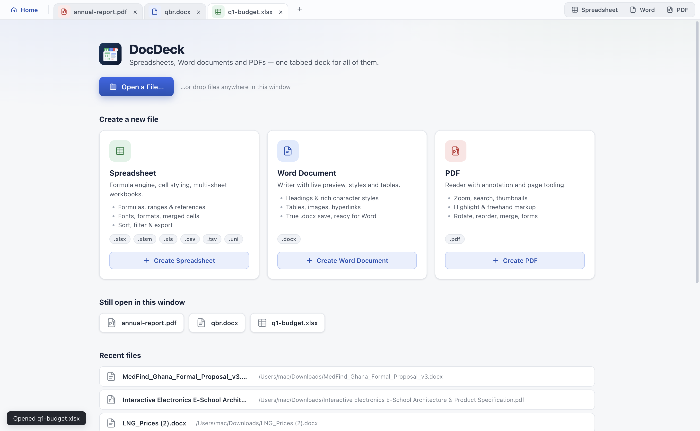
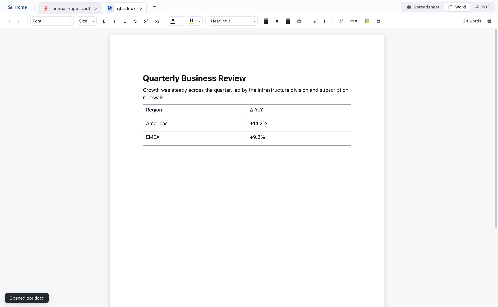
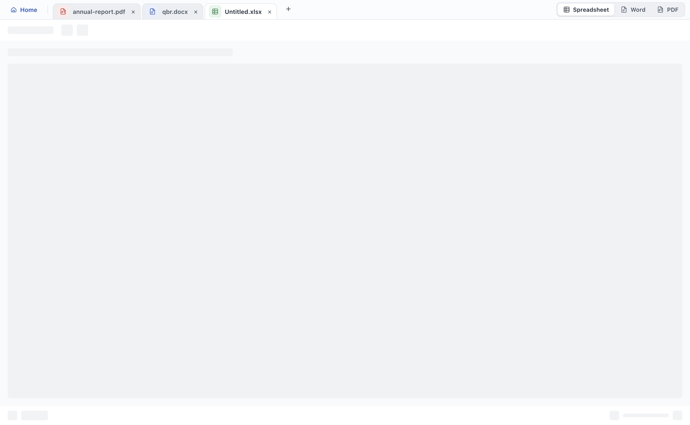
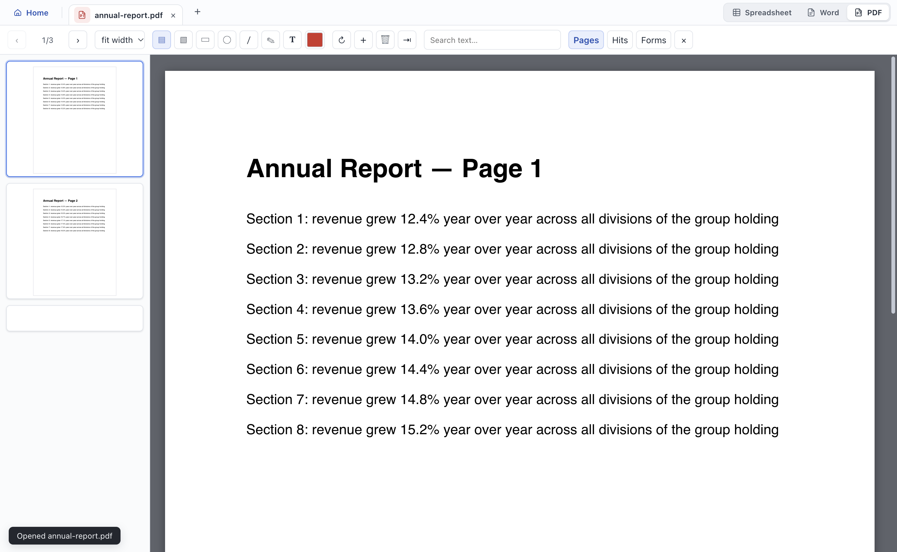

# DocDeck

<p align="center">
  
</p>

**Spreadsheets, Word documents and PDFs — one tabbed deck for all of them.**

DocDeck is a native desktop document workspace (Electron + React). Open an `.xlsx`,
a `.docx` and a `.pdf` side by side in one window, edit them for real, and save back to
their native formats. No accounts, no uploads, no "upgrade to Pro" — everything happens
locally in a sandboxed renderer.

<p align="center">
  
  
</p>
<p align="center">
  
  
</p>

## The three lenses

| | What it is | Highlights |
|---|---|---|
| **Spreadsheet** | True xlsx/xls/csv editor on [Univer](https://github.com/dream-num/univer) + ExcelJS | formula engine (`SUM`, ranges, cross-sheet refs), number formats, fonts/colors/borders, merged cells, sort & filter, multi-sheet workbooks, `.uni` snapshots — saves back to real `.xlsx` |
| **Word** | WYSIWYG `.docx` editor on [Tiptap](https://tiptap.dev) (ProseMirror) | click-to-edit A4 page generated from the document's own section properties, Word-style ribbon (font/size/color/highlight/style), headings, lists with real OOXML numbering, tables, inline images, hyperlinks as document relationships, true `.docx` round-trip |
| **PDF** | Reader + annotator on pdf.js + pdf-lib | page thumbnails, zoom/search, text & freehand highlight, rotate/reorder pages, merge, fill interactive forms (text fields, checkboxes, dropdowns, radio groups), full PDF export |

Word documents round-trip through a hand-written OOXML pipeline: `document.xml` is parsed
into a neutral block model, converted to ProseMirror JSON for editing, then written back —
styles, numbering definitions, section properties, media and hyperlink relationships all
survive the trip (verified by 41 unit tests + a full-save e2e that opens the output).

## Why it's different

- **No conversion layer that lies.** DocDeck parses native formats itself instead of
  inventing an intermediate "slides" or "canvas" format. What you save is what Word,
  Excel and Acrobat open.
- **Local-first.** Files never leave the machine; the Electron sandbox talks to disk
  through a small, auditable preload bridge.
- **Multiple documents, one window.** Browser-style tabs per document kind, dirty-state
  tracking, unsaved-changes guard on quit and close, drag-and-drop multi-file open,
  recent files, and a Home screen that resumes what you had open.

## Notable engineering problems solved

- Tiptap's `setContent` silently corrupts block structure in v2.27 — DocDeck swaps whole
  documents through a raw ProseMirror `EditorState` instead.
- OOXML `<w:sdt>` content controls (Word TOCs), numbering definitions, sectPr page geometry
  and image/media relationships are all handled without library help.
- Form fields on PDFs work because `pdf-lib` field types are discriminated with
  `instanceof` against subclasses, then explicitly `addToPage`d.

## Development

```bash
npm install
npm run dev        # Vite + Electron with live reload
npm run app        # production build + run
npm test           # io + pdf + docx unit suites (pure Node, no Electron needed)
npm run typecheck
```

E2E drivers run the real app with CDP: `scripts/e2e.mjs`, `scripts/e2e-pdf.mjs`,
`scripts/e2e-docx.mjs` (set `DOCDECK_DEBUG_PORT` before launching Electron).

```
src/
  App.tsx               tabbed dispatcher, dirty guards, drag & drop
  home/Home.tsx         Home screen (create cards, resume chips, recents)
  docx/                 OOXML model, block<->tiptap conversion, Tiptap kit, lens
  sheetview/            Univer workspace + xlsx IO
  pdfview/              pdf.js viewport + pdf-lib annotation/form ops
  io/                   xlsx/xls/csv/tsv readers & writers
  types/docdeck.d.ts    the documented renderer<->main bridge
```

## Packaging

`npm run package` builds a macOS `.dmg` (electron-builder, `build/icon.icns`).

## License

MIT — see [LICENSE](LICENSE).
